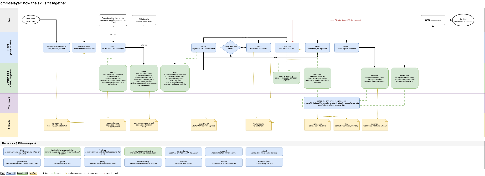

# cmmcslayer

Agent skills for taking a defense contractor through NIST SP 800-171 Rev 2 and a CMMC Level 2 assessment.

Most compliance tooling tells you what the 110 requirements say. You can already read that. What nobody writes down is where the bar is: what assessors accepted, what they rejected, what was a waste of money, and which arguments depend on who shows up that day. That is what this repo holds.

It is built from a practitioner wiki written while passing a Level 2 assessment. The repo keeps the judgment calls and leaves out the names and the private conversations, and a check in the repo enforces that.

## Who it is for

There are two seats. Setup asks you to tell it about your role, works out your seat from the answer, and records it once in the engagement's `CONTEXT.md`. The seat changes how the skills talk to you. Both seats get the same skills.

**Consultant.** You run engagements for clients. You get the engagement vocabulary as is, and Seat notes aimed at running the work for someone else.

**OSC.** You are the company seeking certification, usually its IT lead. You get plain language, and each step tells you who in the company you need, because most of the answers are not in IT.

## How it fits together

The skills form one main flow with three on-ramps, and a router tells you where you are.



```
find-cui -> scope -> gap -> remediate -> document -> evidence -> mock -> assessment -> closeout -> monitoring
```

**Start with `/ask-poamslayer`.** Say where you are and what just landed on your desk. It names the next skill.

**Everything starts at `find-cui`.** The first question is whether you have CUI and where it goes, and it comes before scoping, a gap assessment, or buying a tenant. The IT lead cannot answer it alone, because the answer is in contracts, engineering, the shop floor, purchasing, and the owner's head. So `find-cui` gets it from those people. It trains them first, interviews them by role, talks to IT last, and then maps what it heard into a data flow. A scope drawn before that step rests on a guess.

After `find-cui`, the skills work in a loop. `audit` reads what the engagement has and reports each of the 320 assessment objectives MET or NOT MET with its letter and the missing evidence. `to-poam` turns those into tickets, and refuses to write a POA&M that regulation does not allow you to have. `remediate` takes one ticket and closes it only when a fresh audit says every objective is MET. `to-ssp` writes one conformity statement per objective and component, and `ssp-lint` catches the contradiction between your plan and your procedure before an assessor spends one of your document corrections on it.

Three on-ramps merge in: `triage` for findings someone else wrote, `significant-change-determination` for a change to a certified environment, and `wayfinder` for an engagement with more contested calls than one session can hold.

## The SSP is one file, and one skill writes it

The engagement's SSP is `ssp/ssp.json`, an OSCAL document. It holds the components, the assets and their categories, the providers and their FedRAMP status, and one conformity statement per objective and component. Only `scribe` changes it. Every other skill that decides something calls `scribe` to record the decision, and `scribe` validates each change with oscal-cli and refuses one that fails.

People read the SSP as Markdown in `view/`, which `scribe` generates from `ssp.json`. Nobody edits `view/`, and no skill reads it. A skill that needs to know what the SSP says asks `scribe` to show it. See `docs/adr/0007-oscal-ssp-is-the-record-and-scribe-writes-it.md`.

An unconfirmed fact never goes into a statement. It goes on `scope/open-items.md`, and its objective stays planned until someone confirms it (`docs/adr/0010-open-items-stay-outside-the-record.md`).

## The part that does not exist anywhere else

`control-evidence-lookup`. Ask what satisfies 3.1.1 and you get five things: what has been accepted, what has been rejected, what is over-engineering, the edge cases that are still open, and the artifacts that passed. One file per requirement, all 110 of them, and every bullet carries the objective letters it bears on.

Where assessors disagree, it says so and gives you both positions instead of picking one. Where the source was thin, the file says low confidence and stays short rather than padding. Fourteen of the 110 are marked that way, and they are the shortest files in the repo on purpose.

The over-engineering list matters most for cost, because most of the money in this work goes to controls that no requirement asked for. `over-engineering-guard` answers one question: which assessment objective requires this?

## Install

```bash
npx skills@latest add poamslayer/cmmcslayer
```

Pick the skills you want. Make sure `setup-poamslayer-skills` is one of them.

Then, in an empty repo for the client:

```
/setup-poamslayer-skills
```

It asks you to tell it about your role and records your seat from the answer. It scaffolds the engagement repo, sets up the tracker and the labels, and warns you if the regulatory status brief has gone stale.

The new repo has the SSP as one OSCAL document, `ssp/ssp.json`, which only the `scribe` skill changes, and a read-only Markdown view of it in `view/`. It has one folder per requirement in `evidence/`, and the scope, policy, and decision folders the rest of the skills read.

## What it does not cover

Level 1 per-control content, Level 3, and 800-172. Rev 3 control text, beyond the deltas that are already changing decisions today. SPRS submission mechanics and incident reporting fields. Non-Microsoft stacks, beyond passing mentions. Document templates. The skills describe the shape of an SSP statement, a POA&M, and a responsibility matrix, and you bring your own.

Each of these is out of scope because the source material does not cover it, and the repo does not fill the gap with guesses.

## A note on sources

Every claim traces to a public source, and every cited URL is listed once in `reference/authorities.md` with a tier. The tier limits what the source can support:

1. Regulation and statute, such as 32 CFR Part 170, the DFARS clauses, and 800-171 with 800-171A, can establish a rule.
2. Official federal guidance, such as the Scoping Guide, the Assessment Guide, the DoD CIO FAQs, and the CUI Registry, says how the government reads a rule.
3. Public secondary sources, such as a talk you can go and watch, a public wiki, or vendor documentation, support a method, never a status.
4. Practitioner consensus is what practitioners have found in the field. The skill says so and names nobody.

Whether something is CUI is a status question, so a skill answers it only from tier 1 or tier 2. `verify.sh` fails on a citation missing from the register. See `docs/adr/0004-authority-tiers.md`.

The material came from people talking candidly in a private room. The repo publishes what they learned and leaves out who they are. `scripts/scrub_check.py` checks every file on every run and fails the build when a file breaks that rule, so nobody has to remember it.

## How this repo was published

This public repository is a fresh copy of a private working repository, made on 2026-10-05 with no history. The planning documents and the private term lists the scrub check reads stay in the private repository, because they name the community this material came from. That is why the history here starts at one commit.

The control files already reach readers another way. `scripts/sync_dictionary.py` copies them one way into `cmmc-dictionary`, a separate public repository that serves `dictionary.poamslayer.com`, and strips `vault_sources` on the way. A deploy carries no git history, so the site did not have to wait for the gate. It does not settle publishing this repository either. See `docs/adr/0003-dictionary-site-is-a-separate-public-repo.md`.

## Working on this repo

Read `AGENTS.md` first. It holds the editing rules, and `CONTEXT.md` holds the glossary every skill uses.

To check your change before you commit, run the full check:

```bash
bash scripts/install_oscal_cli.sh   # once per machine; needs Java 11 or later
bash scripts/verify.sh
```

The install script links `oscal-cli` into `~/.local/bin`, so that folder has to be on your `PATH`.

If you added or changed a citation, also run `python3 scripts/check_links.py`. It needs network access, so `verify.sh` does not run it.

To test a skill against the fictional machine shop in `docs/fixture/`, run `python3 scripts/cold_run.py --skill <name>`. It works on a copy, so the fixture stays as it is. Graded results go in `docs/cold-runs/`.

## Licence

MIT. The flow skills are derived from [mattpocock/skills](https://github.com/mattpocock/skills), also MIT. See `skills/flows/LICENSE-mattpocock`.
